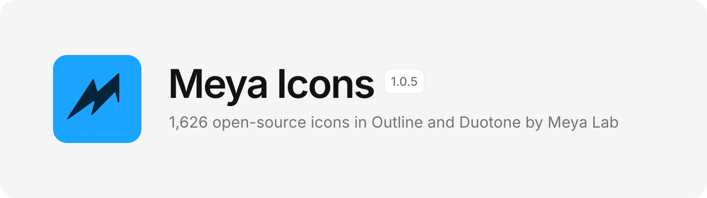
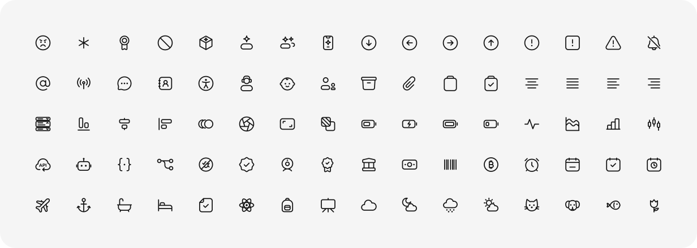
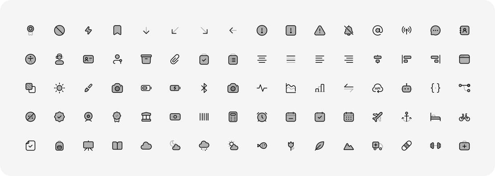

<picture>
  <source media="(prefers-color-scheme: dark)" srcset="./assets/banner-dark.svg">
  
</picture>

# Meya Icons

Meya Icons is a free, open-source set of <!--count-->2612<!--/count--> icons drawn by [Meya Lab](https://meyalab.com), in <!--stylenames-->**Outline** and **Duotone**<!--/stylenames--> styles. Every icon sits on a 24 × 24 grid and uses `currentColor`, so it picks up the text color around it. Icons are drawn with a 1.3 px stroke with round caps and joins, and ship with that stroke outlined into shapes, so they look the same in every app and at every size.

[](https://www.npmjs.com/package/meya-icons)
[](#categories)
[](https://github.com/nazmijavier/meya-icons/releases)
[](./LICENSE)

**[Browse and copy the icons](https://icons.meyalab.com/)** · **[Figma plugin](https://www.figma.com/community/plugin/1685393903679180914)** · **[Hire Meya Lab](https://meyalab.com/contact)**

<!--previews-->
<picture>
  <source media="(prefers-color-scheme: dark)" srcset="./assets/preview-outline-dark.svg">
  
</picture>

<picture>
  <source media="(prefers-color-scheme: dark)" srcset="./assets/preview-duotone-dark.svg">
  
</picture>
<!--/previews-->

## Styles

<!--styles-->
| Style | Icons | Look |
| --- | ---: | --- |
| [Outline](./icons/outline) | 1158 | 1.3 px lines, outlined into shapes |
| [Duotone](./icons/duotone) | 1156 | The same lines, plus a 30% tint fill for depth |
| [Stroke](https://icons.meyalab.com/#stroke) `PRO` | 1158 | Live 1.3 px strokes you can make thinner or bolder |
| [Stroke Duotone](https://icons.meyalab.com/#stroke-duotone) `PRO` | 1156 | Live strokes with a 30% tint fill, thinner or bolder |
| [Sharp](https://icons.meyalab.com/#sharp) `PRO` | 1158 | Strokes with square caps and mitered corners |
| [Filled](https://icons.meyalab.com/#filled) `PRO` | 1158 | Solid shapes for active and selected states |
| [Glass](https://icons.meyalab.com/#glass) `PRO` | 1158 | Glossy glass in a blue-to-violet gradient |
| [Animated](https://icons.meyalab.com/#animated) `PRO` | 104 | Icons that move, each with its own motion, as animated SVG |
| Pixel `PRO` | Coming soon | Solid cells on a 12 × 12 grid, made with the Pixel Lab |
| 3D `PRO` | Coming soon | Rendered 3D icons with depth and soft light |
| [Cursors](./icons/outline/cursors) | 43 | Full-color cursors: arrows, hands, text, resize and more |
| [Flags](./icons/outline/flags) | 255 | Full-color country and territory flags, 3:2 with rounded corners |
<!--/styles-->

Outline, Duotone, Stroke, Sharp and Filled use `currentColor`; Cursors and Flags carry their own colors. Duotone tints use `fill-opacity`, so both tones follow the one color you set.

Since 2.0, Outline and Duotone have their strokes outlined into solid shapes, so the line weight is fixed at 1.3 px. Live strokes you can make thinner or bolder are the **Stroke** style in [Meya Icons Pro](https://icons.meyalab.com/pricing). Releases before 2.0 keep their strokes and stay MIT.

## Get the icons

- **Copy one icon.** Open the [website](https://icons.meyalab.com/), choose a style, search, pick an icon, and copy it as SVG or as a React component. You can change the size and color before you copy.
- **Use them in Figma.** Install [Meya Icons for Figma](https://www.figma.com/community/plugin/1685393903679180914) from the Community and place icons straight onto your canvas.

- **Install the package.**

  ```bash
  npm i meya-icons
  ```

## Usage

### HTML

Paste the SVG inline. The icon takes the color of its parent.

```html
<button style="color: #1BA4FF">
  <svg xmlns="http://www.w3.org/2000/svg" width="24" height="24" viewBox="0 0 24 24" fill="none">
    <!-- paths from icons/outline/general/home.svg -->
  </svg>
  Home
</button>
```

### React

```jsx
import { Home, Search } from "meya-icons/react/outline";
import { Heart } from "meya-icons/react/duotone";

<Home />                          // 24px, inherits the text color
<Search size={20} />
<Heart color="#0071E3" />
```

Components forward a ref and take any SVG prop, so `className`, `onClick` and `aria-label` all work. Where a name appears in more than one category the first keeps the plain name and the rest carry theirs, so `camera` is `Camera`, `MediaDevicesCamera` and `SecurityCamera`.

### Figma

Drag any SVG from [`icons/`](./icons) onto the canvas. Each icon comes in as one shape (Duotone: its tint as a second, 30% layer), ready to recolor.

## Design specs

| Property | Value |
| --- | --- |
| Grid | 24 × 24 px |
| Live area | 20 × 20 px (2 px padding) |
| Stroke | 1.3 px, centered, outlined into shapes |
| Caps and joins | Round |
| Color | `currentColor` |

## Categories

<!--categories-->
| Category | Outline | Duotone |
| --- | ---: | ---: |
| General | [106](icons/outline/general) | [106](icons/duotone/general) |
| AI | [156](icons/outline/ai) | [156](icons/duotone/ai) |
| Arrows | [37](icons/outline/arrows) | [37](icons/duotone/arrows) |
| Alerts & Feedback | [18](icons/outline/alerts-feedback) | [18](icons/duotone/alerts-feedback) |
| Communication | [32](icons/outline/communication) | [32](icons/duotone/communication) |
| Users | [65](icons/outline/users) | [65](icons/duotone/users) |
| Files | [34](icons/outline/files) | [34](icons/duotone/files) |
| Editor | [37](icons/outline/editor) | [37](icons/duotone/editor) |
| Layout | [83](icons/outline/layout) | [83](icons/duotone/layout) |
| Images | [66](icons/outline/images) | [66](icons/duotone/images) |
| Media & Devices | [70](icons/outline/media-devices) | [70](icons/duotone/media-devices) |
| Charts | [20](icons/outline/charts) | [20](icons/duotone/charts) |
| Development | [33](icons/outline/development) | [33](icons/duotone/development) |
| Security | [20](icons/outline/security) | [20](icons/duotone/security) |
| Finance & E-commerce | [98](icons/outline/finance-ecommerce) | [98](icons/duotone/finance-ecommerce) |
| Time | [21](icons/outline/time) | [21](icons/duotone/time) |
| Maps & Travel | [36](icons/outline/maps-travel) | [35](icons/duotone/maps-travel) |
| Education | [27](icons/outline/education) | [27](icons/duotone/education) |
| Weather | [21](icons/outline/weather) | [20](icons/duotone/weather) |
| Nature | [19](icons/outline/nature) | [19](icons/duotone/nature) |
| Health | [12](icons/outline/health) | [12](icons/duotone/health) |
| Fitness | [79](icons/outline/fitness) | [79](icons/duotone/fitness) |
| Food & Drink | [28](icons/outline/food) | [28](icons/duotone/food) |
| Home & Living | [16](icons/outline/home) | [16](icons/duotone/home) |
| Shapes | [24](icons/outline/shapes) | [24](icons/duotone/shapes) |
<!--/categories-->

## Adding icons

1. Export the new icons from Figma as SVG, strokes and all. Name each file `category-name.svg`, for example `weather-sun.svg` or `Icon=weather-sun.svg`.
2. Import them into the Pro stroke folders. The live strokes are the Pro Stroke style, so they stay out of this repo:

   ```bash
   node scripts/import.mjs ~/path/to/exports --out ../meya-icons-pro/stroke
   node scripts/import.mjs ~/path/to/duotone-exports --out ../meya-icons-pro/stroke-duotone
   ```

3. Outline them into `icons/`. Every stroke becomes the shape it draws, caps, joins and dots included (needs `npm i` once, for CanvasKit). Add a name filter to outline only some icons:

   ```bash
   node scripts/outline.mjs ../meya-icons-pro/stroke
   node scripts/outline.mjs ../meya-icons-pro/stroke-duotone --style duotone
   ```

4. Rebuild the website, the README images and the icon counts:

   ```bash
   node scripts/build.mjs
   ```

Stroke, Sharp, Filled, Pixel, 3D and Glass are Pro styles. Their SVGs live in `../meya-icons-pro/<style>/`, never in `icons/`, so they don't ship under the MIT license. The website shows the Pro styles that have shipped (marked `showcase` in `scripts/styles.mjs`) from image previews in `docs/pro/`, with copying locked for everyone but signed-in Pro customers (see below); the others show as coming soon. Full-color styles (marked `color`) are previewed as they are, the rest as one-color shapes that follow the site's color picker. After changing a shipped Pro style's icons, refresh the previews before you build:

```bash
node scripts/pro-previews.mjs   # needs Playwright: npm i -D playwright && npx playwright install chromium
node scripts/build.mjs
```

On a computer whose `../meya-icons-pro` lacks some Pro icons, use `node scripts/pro-previews.mjs --add` instead: it renders only the icons the previews don't have yet and adds them to the end of each sprite, leaving every other preview as it is.

Nothing of Pro may be committed here. `scripts/guard.mjs` checks for Pro SVGs, live strokes, oversized previews, the owner build and anything copied from `../meya-icons-pro`. It runs on every push and pull request (`.github/workflows/pro-guard.yml`). Turn on the same check before each commit, once per clone:

```bash
npm run hooks    # then every commit runs: node scripts/guard.mjs --staged
```

Rebuild the npm package with:

```bash
node scripts/package.mjs
```

It writes `dist/`, which is what gets published.

The website is static pages in [`docs/`](./docs) plus a few functions in [`api/`](./api), hosted on Cloudflare Workers (see [`wrangler.jsonc`](./wrangler.jsonc) and [`worker.js`](./worker.js)). Workers static assets serve `docs/` and nothing else from the repository; requests to `/api/*` run the functions:

- `api/geo` tells the pricing page the visitor's country, so it shows Rupiah in Indonesia and US dollars elsewhere.
- `api/auth/*` is the Pro login. Customers get a sign-in code from Polar by email (or use their Pro license key); the functions check with Polar that they hold the Meya Icons Pro benefit and keep a signed session cookie. Access is re-checked daily.
- `api/pro` serves one Pro SVG at a time to signed-in customers, read from the private `meya-icons-pro` repository, so they can copy Pro icons from the site.
- An access code opens Pro without a Polar purchase (the owner's own): it goes in the license-key field, on the site and in the Figma plugin. `PRO_ACCESS_CODES` in `wrangler.jsonc` lists the allowed codes as `label:hash` pairs, only their SHA-256 hashes, so the codes themselves are never in the repository (see `api/_lib/access.js`). `node scripts/access-code.mjs <label>` makes a new code and its pair; remove a pair and deploy to revoke a code, which ends its sessions on their next request.
- `api/plugin/*` is the same login and `api/pro` for the Figma plugin. The plugin's window has no origin of its own, so it can't use the cookie: `license` and `session` hand it a signed token instead, which it keeps in Figma's client storage and sends as `Authorization: Bearer`. `me` checks the token, `pro` serves the Pro SVGs. These routes answer any origin (CORS), which is safe because they never read the cookie. A token renewed by the daily re-check comes back in the `X-Meya-Token` header.

The Polar ids are plain variables in `wrangler.jsonc`: `POLAR_ORG_ID` and `POLAR_PRO_BENEFIT_ID` (the Pro product's License Keys benefit). The login stays hidden until the Worker also has these secrets (see the Deploy workflow below): `SESSION_SECRET` (32+ random characters, made by the workflow), `PRO_GITHUB_TOKEN` (fine-grained, Contents read-only on `meya-icons-pro`) and, for the daily re-check, `POLAR_ACCESS_TOKEN` (scopes `benefits:read`, `license_keys:read` and `license_keys:write`). Optional: `POLAR_API_URL` for Polar's sandbox, `PRO_REPO`, `PRO_REF`.

The [Deploy](./.github/workflows/deploy.yml) workflow publishes the site from the branch it names (so don't also connect the repository to Cloudflare's Workers Builds): the Pro guard, `wrangler deploy`, the Worker's secrets, then [`scripts/smoke.mjs`](./scripts/smoke.mjs) against the deployed copy. If those checks fail, the previous version goes back live. Started by hand, it also has the tasks `secrets`, `status`, `cutover` (sends `icons.meyalab.com` to the Worker with no gap: the route `icons.meyalab.com/*`, then a proxied record; undoes itself if the checks fail) and `rollback`; GitHub shows no "Run workflow" button for a workflow outside the default branch, so start them with `gh workflow run deploy.yml --ref <branch> -f task=status`. To undo a cutover from the Cloudflare dashboard instead: remove the `icons.meyalab.com/*` route, then delete the DNS record commented "meya-icons cutover: placeholder" (or set the one commented "was DNS only" back to DNS only). [`scripts/cloudflare.mjs`](./scripts/cloudflare.mjs) does the Cloudflare side. It needs one repository secret, `CLOUDFLARE_API_TOKEN`, with at least Account > Workers Scripts > Edit and, on the `meyalab.com` zone, Zone > Read, Workers Routes > Edit, Zone Settings > Read and DNS > Read (the header of `scripts/cloudflare.mjs` says when a cutover needs more). `SESSION_SECRET` is made once on the Worker and never shown; `POLAR_ACCESS_TOKEN` and `PRO_GITHUB_TOKEN` are added as repository secrets of the same names: a deploy copies the ones the Worker lacks, the `secrets` task replaces them. They can also reach the Worker without a repository secret: the `handoff` task waits for them sealed to a key that only that run holds ([`scripts/handoff.mjs`](./scripts/handoff.mjs)), checks that they work, and sets them. wrangler is pinned with its dependencies by `.github/deploy/package-lock.json`. `docs/_headers` adds HSTS. To run the site locally with the functions: `npx wrangler dev`, with the variables in a `.dev.vars` file (git ignores it).

Each function takes a Web `Request` and returns a `Response`, the form Vercel also runs: [`vercel.json`](./vercel.json) is the previous host's setting, kept until the move to Cloudflare is finished.

## License

The free icons and the code are released under the [MIT License](./LICENSE). You can use them in personal and commercial projects. Credit is appreciated but not required.

Meya Icons Pro is not open source. The Pro styles and their previews in `docs/pro/` are © Meya Lab, all rights reserved, and licensed only to Pro customers. See [NOTICE.md](./NOTICE.md) for what the MIT License covers.

---

<a href="https://meyalab.com">
  <picture>
    <source media="(prefers-color-scheme: dark)" srcset="./assets/wordmark-white.svg">
    
  </picture>
</a>

Made by [Meya Lab](https://meyalab.com), a design studio that builds brands, websites and apps. Need a custom icon set? [Hire us](https://meyalab.com/contact).
